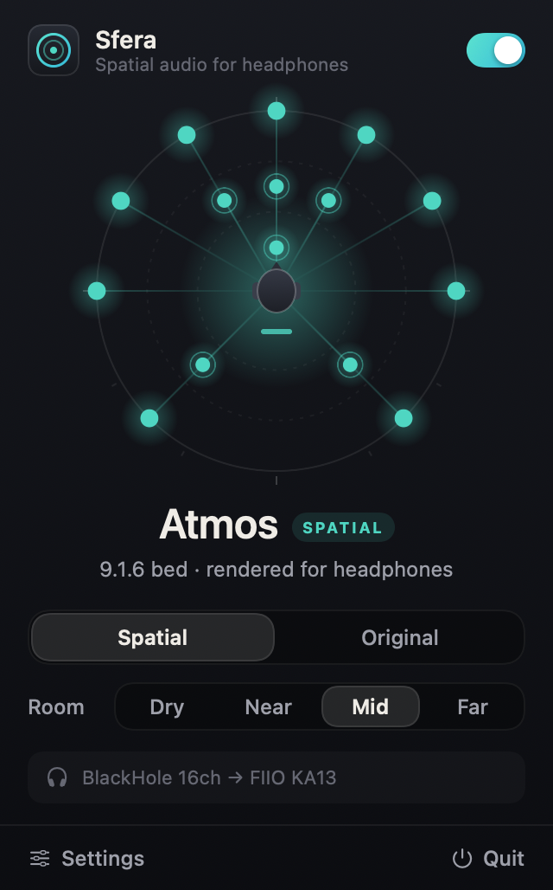
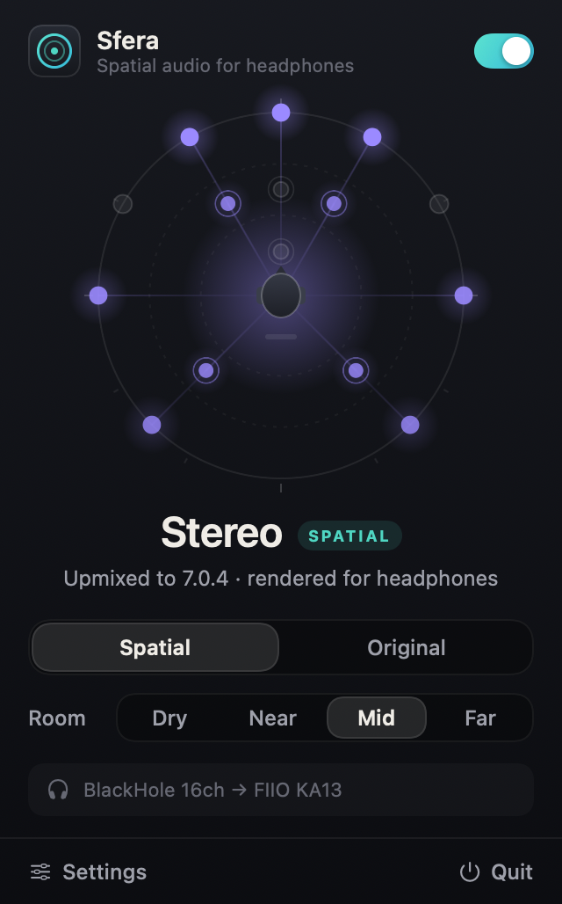
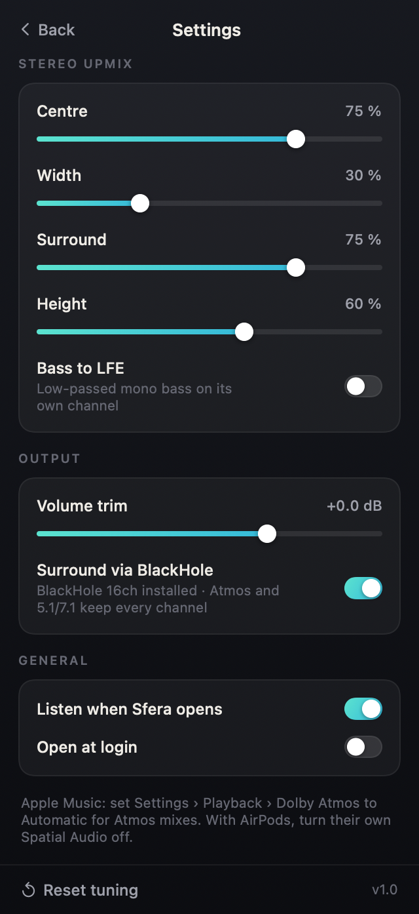

# Sfera

Spatial audio for headphones, from the menu bar. Turn it on and everything your Mac plays gets the "stereo Atmos" treatment:

- **Stereo → spatial.** Apple Music, Spotify, a browser, any player. Stereo is upmixed to a 7.0.4 layout (centre, wide front stage, surround and height ambience) and rendered binaurally, so it sounds like speakers around you rather than inside your head.
- **Surround and Atmos → spatial.** A film's 5.1 or 7.1, or Apple Music's Dolby Atmos, keeps its own channels (up to a 9.1.6 bed) and is rendered binaurally, so the height and surround survive on two ears.

<p align="center">
  
  &nbsp;
  
  &nbsp;
  
</p>

## Use it

```sh
./Scripts/package_app.sh release   # builds and signs Sfera.app
open Sfera.app
```

Sfera has no window and no Dock icon. It lives in the menu bar (headphones icon: outline = off, ring = on, filled = spatial). Click it for the panel:

- **The switch** turns listening on and off. Off hands the Mac's sound back exactly as it was.
- **The sound field** shows what you're hearing. Teal dots are the channels that are really arriving (5.1, 7.1, Atmos). Violet dots are the virtual speakers the stereo upmix creates.
- **Spatial / Original** compares at matched loudness, so the comparison is fair.
- **Room:** Dry / Near / Mid / Far is how much virtual room you hear. Mid sounds most like speakers.
- **Settings** (bottom left) has the upmix tuning (centre, width, surround, height, bass to LFE), a volume trim, the BlackHole switch, "Listen when Sfera opens" and "Open at login".

How much Sfera can hear depends on whether [BlackHole 16ch](https://existential.audio/blackhole/) is installed:

| | With BlackHole 16ch (recommended) | Without |
|---|---|---|
| How it hears your Mac | Sfera makes BlackHole the system output while it runs and plays the result to your real headphones/DAC. Your previous output comes back when Sfera stops or quits. | A Core Audio process tap on everything except Sfera. |
| What arrives | Every channel apps send: Apple Music Atmos as a 9.1.6 bed, a video player's 5.1/7.1, or stereo | Stereo only (macOS folds surround down first) |
| Permission | *Microphone* (macOS counts BlackHole as a microphone; nothing is recorded) | *Screen & System Audio Recording* |
| Apple Music › Dolby Atmos | **Automatic** or **Always On** | **Off** (otherwise you'd hear Apple's own headphone render) |

The Mac's output menu (menu bar › Sound) stays the switch while Sfera runs. Choose your headphones/DAC and Sfera plays stereo straight to it, leaving the output where you put it. Choose BlackHole again for surround. If the BlackHole route can't start, Sfera falls back to stereo on your real device, never to silence. Routing decisions are logged to `~/Library/Logs/Sfera.log`.

**Files and movies** play in any player (Music, QuickTime, IINA, VLC, a browser). Sfera spatialises whatever reaches the system output, so the built-in player of earlier versions is gone.

**Volume.** While the Mac plays to BlackHole, the volume keys set BlackHole's volume, which scales everything Sfera receives. Sfera puts BlackHole's slider in the middle each time listening starts, so the volume keys have room both ways. Set your headphones'/DAC's own volume to suit.

With AirPods, turn their own **Spatial Audio** off so the sound isn't processed twice.

Requires macOS 15+ and a Swift 6 toolchain (Command Line Tools are enough). The bundled build is Apple Silicon and ad-hoc signed (not notarized).

## What changed in 1.0

Sfera 1.0 is a ground-up rewrite of the engine and app, with the same sound:

| | 0.9 | 1.0 |
|---|---|---|
| App | Full window app with a file/movie player | Menu bar only (`LSUIElement`) |
| Engine | Two complete spatializers side by side (stereo + surround), each with its own room and limiter | One spatializer: the upmix and the bed share one head renderer, one room, one limiter |
| Audio path | Capture IOProc → 2048-frame ring buffer → AVAudioEngine | One IOProc on the aggregate device: read, render, write. No ring buffer, so about 43 ms less delay |
| Idle | Everything ran all the time | Upmix sleeps during surround, unused speakers and room sleep, the engine goes dormant after 3 s of silence |
| UI timers | 20 Hz, always | 1 Hz watchdog; 20 Hz meters only while the panel is open |

CPU per second of audio on one M4 core (512-frame blocks, `Bench/run.sh`):

| What's playing | 0.9 | 1.0 | |
|---|---|---|---|
| Stereo via process tap | 2.35 % | 0.73 % | 3.2× less |
| Stereo song via BlackHole | 3.57 % | 0.76 % | 4.7× less |
| 5.1 film via BlackHole | 3.55 % | 0.22 % | 16× less |
| 9.1.6 Atmos via BlackHole | 3.57 % | 0.32 % | 11× less |
| Nothing playing | 2.53 % | 0.08 % | 30× less |

The output is the same: the bench runs both engines on identical input and every case matches to between −83 and −400 dB (details in [docs/VALIDATION.md](docs/VALIDATION.md)). The largest differences are two float glitches in 0.9 that 1.0 no longer has.

## The engine

All rendering is in [`Sources/SferaCore`](Sources/SferaCore); formulas are in [docs/ENGINE.md](docs/ENGINE.md).

- `Upmixer.swift`: stereo → 7.0.4 by per-bin principal-component direct/ambience separation (vectorised: SIMD covariance/eigen pass, batched `atan2`/`sincos`, vDSP synthesis).
- `Binaural.swift`: synthetic-HRTF head renderer (Woodworth ITD, head shadow, elevation notch). Speakers at the same azimuth share one shadow/ITD path.
- `Room.swift`: early reflections + 8-line FDN late tail, and the look-ahead limiter.
- `Spatializer.swift`: the real-time chain. It detects what's arriving (stereo, 3.1, 5.1, 7.1, Atmos), crossfades between upmix and bed, keeps a loudness-matched Original path, and goes dormant in silence.

App side (`Sources/Sfera`): `Session` (one aggregate device: your output as the clock plus BlackHole with drift compensation, or a process tap), `Controller` (routing, permissions, device listeners, prefs), `Devices` (Core Audio helpers), `UI/` (the panel).

## Verification

```sh
./Scripts/check.sh
```

This builds, runs the equivalence and CPU bench against the 0.9 engine (`Bench/run.sh` extracts it from git commit `2b61cdd`), the BlackHole round trip, the process-tap probe and the snapshots. Individual probes:

```sh
BIN="$(swift build -c release --show-bin-path)/Sfera"
"$BIN" --surround-probe            # 16 tagged tones through BlackHole and a real session: every channel in order, detected as Atmos
"$BIN" --tap-probe                 # the no-BlackHole route: process tap → your output
"$BIN" --cpu-probe 10 [--silent]   # live CPU of a real session (inaudible, −90 dB)
"$BIN" --snapshot /tmp/panel.png [--page atmos|film|stereo|stereo-tap|original|off|settings]
```

Run the probes from Terminal: restricted shells read BlackHole as silent and get no tap callbacks.

## Known limits

- **Not Dolby DSP.** The upmixer is an independent PCA upmix, and the binaural renderer is a published-model synthetic HRTF with a generic room, not Dolby's renderer or a personalised HRTF. There is no head tracking.
- **Atmos arrives as a bed, not objects.** Through BlackHole, Apple Music delivers its Atmos decode as 9.1.6 channels; object metadata never leaves Music. Core Audio has no convertible top-middle pair, so the 16-channel layout uses top-centre and front-height-centre labels for channels 13–14, same as Downmix.
- **Delay.** Everything is delayed about 43 ms by the upmix (surround too, so switching between stereo and surround is seamless). Video in other players isn't compensated. That's at the edge of what you'd notice as lip-sync; most players (IINA, VLC) can delay their picture to match.
- Sfera follows the player's sample rate when your output supports it; otherwise it runs both at the output's rate.

Sfera is an independent experiment. Not affiliated with or endorsed by Dolby Laboratories. Dolby and Dolby Atmos are trademarks of their respective owner.
