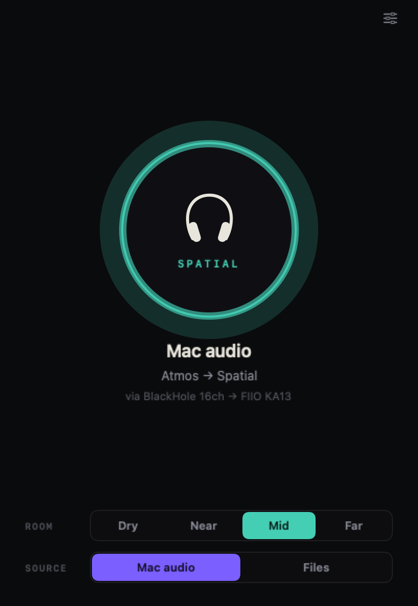
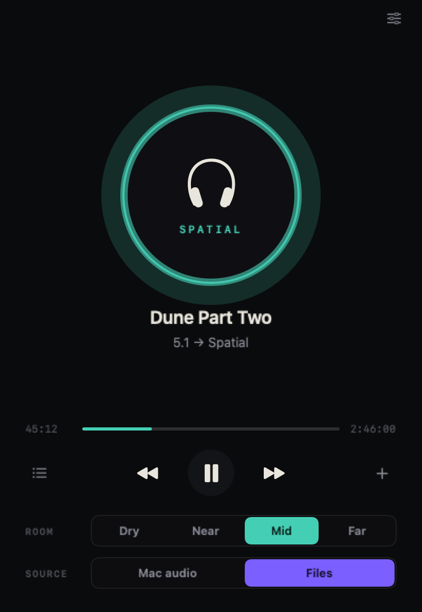

# Sfera

Spatial audio for headphones, as a black box. Turn it on and everything you listen to gets the "stereo Atmos" treatment:

- **Stereo → spatial.** Apple Music, any other app, or your own files. Stereo is upmixed to a 7.0.4 bed (centre, wide front stage, surround and height ambience) and rendered binaurally, so it sounds like speakers around you rather than inside your head.
- **Surround and Atmos → spatial.** A film's 5.1 or 7.1, or Apple Music's Dolby Atmos, keeps its own channels (up to a 9.1.6 bed) and is rendered binaurally, so the height and surround survive on two ears.

<p align="center">
  
  &nbsp;
  
</p>

## Use it

```sh
./Scripts/package_app.sh release   # builds and signs Sfera.app
open Sfera.app
```

Sfera listens to your Mac's audio as soon as it opens. How much it can hear depends on whether [BlackHole 16ch](https://existential.audio/blackhole/) is installed:

| | With BlackHole 16ch (recommended) | Without |
|---|---|---|
| How it hears your Mac | Sfera makes BlackHole the system output while it runs and plays the result to your real headphones/DAC. Your previous output comes back when Sfera stops or quits. | A Core Audio process tap on everything except Sfera. |
| What arrives | Every channel apps send: Apple Music Atmos as a 9.1.6 bed, a video player's 5.1/7.1, or stereo | Stereo only (macOS folds surround down first) |
| Permission | *Microphone* (macOS counts BlackHole as a microphone; nothing is recorded) | *Screen & System Audio Recording* |
| Apple Music › Dolby Atmos | **Automatic** or **Always On** | **Off** (otherwise you'd hear Apple's own headphone render) |

The Mac's output menu (menu bar › Sound) is the switch while Sfera runs: choose your headphones/DAC and Sfera plays stereo straight to it, leaving the output where you put it; choose BlackHole again for surround. If the BlackHole route can't start, Sfera falls back to stereo on your real device, never to silence. Routing decisions are logged to `~/Library/Logs/Sfera.log`.

**Volume.** While the Mac plays to BlackHole, the volume keys set BlackHole's volume, and that scales everything Sfera receives. Sfera puts BlackHole's slider in the middle each time listening starts, so the volume keys have room both ways during the session. BlackHole's slider is linear in dB, so the middle is −32 dB; set your headphones'/DAC's own volume to suit.

Sfera switches by itself between stereo upmixing and the surround path, depending on what is playing. The second line under the button says what it receives ("Atmos → Spatial", "5.1 → Spatial", "Stereo → Spatial").

- **Files:** pick *Files* and drop songs, albums, folders or movies on the window, or use *Open With › Sfera* in Finder. A movie opens in its own window with the picture locked to the spatial sound; double-click it for full screen.
- **The big button** switches between Spatial and Original at matched loudness, so the comparison is fair.
- **Room:** Dry / Near / Mid / Far is how much virtual room you hear. Mid sounds most like speakers.
- With AirPods, turn their own **Spatial Audio** off so the sound isn't processed twice.
- Closing the window keeps Sfera in the menu bar (headphones icon). Settings (⌘,) has volume, the upmix controls, "Use BlackHole for surround and Atmos", the output Sfera plays to, and "start listening on launch".

Plays AAC, ALAC, MP3, FLAC, WAV, AIFF, CAF, Dolby Digital (AC-3/E-AC-3) and MP4/MOV/M4V movies. Long movies stream from disk. MKV isn't supported, because macOS's media frameworks can't open it.

Requires macOS 15+ and a Swift 6 toolchain. The bundled build is Apple Silicon and ad-hoc signed (not notarized).

## Shortcuts

| Action | Shortcut |
|---|---|
| Play / pause (files) · Spatial ↔ Original (live) | Space |
| Spatial ↔ Original | ⌘S |
| Next / previous | ⌘→ / ⌘← |
| Forward / back 10 s | → / ← |
| Open files | ⌘O |
| Show the window | ⌘1 |
| Settings | ⌘, |

## Sfera and the Downmix app

The sibling `../downmix_renderer` (Downmix) also reads BlackHole 16ch, and both install the same 16-channel layout on it, so they never fight over the device. Run only one at a time. What each one does with the channels is different:

| | Downmix | Sfera |
|---|---|---|
| 9.1.6 → 2.0 | Fixed speaker fold-down matrix (ADC2-direct coefficients, LFE low-pass) | Binaural rendering: per-channel ITD, head shadow, pinna/elevation notch, plus a virtual room |
| On headphones | Plain stereo: heights and surrounds collapse between your ears | Heights, sides and rears keep their direction outside your head |
| Stereo sources | Passed through | Upmixed to 7.0.4, then rendered binaurally |
| Without BlackHole | Doesn't work | Stereo via process tap |
| Routing | You set BlackHole as output yourself | Switches the output to BlackHole and back automatically |
| Movies | — | Built-in player, picture locked to the sound |
| Bit depth / rate following, logs | Yes, mature | Follows the rate; float pipeline |

Downmix is the right tool for speakers or a stereo fold-down that measures like a reference. Sfera is for headphones.

## The engine

All rendering is in [`Sources/SpatialCore`](Sources/SpatialCore); formulas are in [docs/ENGINE.md](docs/ENGINE.md).

- `Render/Upmixer.swift`, `Live/StreamingUpmixer.swift`: stereo → 7.0.4 by per-bin principal-component direct/ambience separation.
- `Render/BinauralRenderer.swift`, `Render/BinauralRoom.swift`: synthetic-HRTF binaural renderer and the virtual room.
- `Live/LiveSpatializer.swift`: the real-time chain (upmix or bed → binaural + room, loudness-matched Original path, limiter).
- `Live/AdaptiveSpatializer.swift`: runs the stereo and bed paths side by side for a BlackHole input and crossfades to whichever matches what is arriving.
- `IO/`, `ADM/`: WAV/RF64 (with ADM BWF beds and objects), AVFoundation and ffmpeg import.

App side (`Sources/Sfera/Live`): `SurroundCapture` (BlackHole + your output in one drift-corrected aggregate), `SystemAudioCapture` (process tap), `AudioDevices` (routing, rates, layout), `LiveOutput` (AVAudioEngine output with the movie clock), `StreamingFile` and `VideoWindow` (files and movies).

## Verification

```sh
./Scripts/check.sh
```

This runs the build, the engine tests, the headless self-check (upmix, room, live vs offline, A/B loudness, adaptive switching, 5.1 movie decode), the movie sync probe, the BlackHole round trip and the snapshots. Individual probes:

```sh
BIN="$(swift build -c release --show-bin-path)/Sfera"
"$BIN" --self-check /tmp/sfera-check.json
"$BIN" --surround-probe     # 16 tagged tones through BlackHole: every channel must arrive in order
"$BIN" --route-probe        # the app's routing: start on BlackHole, pick your output, pick BlackHole, stop
"$BIN" --movie-probe        # plays a generated 5.1 movie (inaudibly) and measures picture/sound sync
"$BIN" --tap-probe          # process-tap capture
"$BIN" --snapshot /tmp/listen.png [--page listen|listen-tip|listen-files|listen-movie]
```

Results are in [docs/VALIDATION.md](docs/VALIDATION.md).

## Known limits

- **Not Dolby DSP.** The upmixer is an independent PCA upmix, and the binaural renderer is a published-model synthetic HRTF with a generic room, not Dolby's renderer or a personalised HRTF. There is no head tracking.
- **Atmos arrives as a bed, not objects.** Through BlackHole, Apple Music delivers its Atmos decode as 9.1.6 channels; object metadata never leaves Music. Core Audio has no convertible top-middle pair, so the 16-channel layout uses top-centre and front-height-centre labels for channels 13–14, same as Downmix.
- **DRM.** Whether Music sends protected Atmos to a virtual device was not measured here (see VALIDATION).
- Stereo is delayed about 45 ms by the upmix (2 ms for surround). Movies played in Sfera are compensated; video in other apps through BlackHole is not.
- Sfera follows the player's sample rate when your output supports it; otherwise it runs both at the output's rate.

Sfera is an independent experiment. Not affiliated with or endorsed by Dolby Laboratories. Dolby and Dolby Atmos are trademarks of their respective owner.
